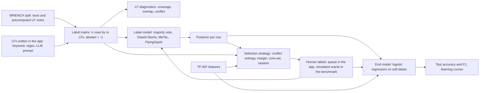
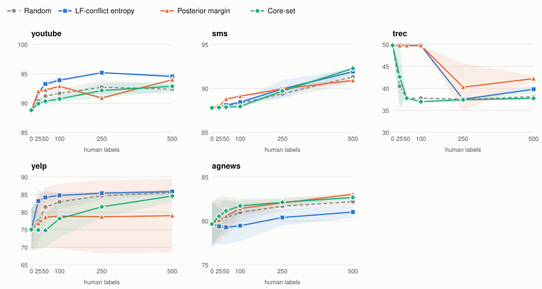

# weak-supervision-workbench

A small web app for building a labelled text dataset without labelling most of it by hand.
You write labelling functions (keyword lists, regular expressions, optionally an LLM prompt),
a label model works out how far to trust each one and turns their votes into probabilistic
labels, and a queue asks you to label only the rows where the functions disagree or the model
is unsure. A TF-IDF + logistic-regression end model is then trained on the result.

The statistical parts are written from scratch on numpy and scipy: the label matrix with
abstains, Dawid-Skene EM, the MeTaL matrix-completion model with class-balance estimation,
FlyingSquid's triplet method, LF diagnostics, three selection strategies, the soft-label end
model and a seeded simulated-oracle loop. Snorkel and scikit-learn appear only as reference
points in the benchmark and the tests. The benchmark runs on five WRENCH text-classification
sets and compares label models with majority vote and Snorkel, and selection strategies with
random sampling.

## Start the workbench

Needs [uv](https://docs.astral.sh/uv/) and Python 3.12.

```bash
uv sync
uv run wsw app                      # bundled demo corpus at http://127.0.0.1:8080
```

The demo corpus (synthetic app-store reviews: bug, feature, praise) is generated from a
fixed seed, so it needs no download. For the WRENCH sets:

```bash
uv run wsw fetch all                # about 70 MB, sha256-checked, into $WSW_DATA_DIR
uv run wsw app --dataset sms        # the app keeps a seeded 5000-row sample (--max-rows 0 for all)
uv run wsw lfs trec                 # the same LF diagnostics, printed in the terminal
```

`WSW_DATA_DIR` defaults to `~/.cache/weak-supervision-workbench`. The image runs the same app
as a non-root user:

```bash
docker build -t weak-supervision-workbench .
docker run --rm -p 8080:8080 weak-supervision-workbench
```

## A session, step by step

### 1. Write a labelling function

The **Write LFs** tab has one form. Pick *keyword* or *regex*, name the function, give the
keywords (comma-separated, matched as whole words or phrases, case-insensitive) or the
pattern, and choose the class it votes for. Everywhere else it abstains. On the demo corpus,
`kw_sync` with keywords `sync, export` voting *bug* is a reasonable first try.

After **Add LF** the table below updates. For every function it shows:

| Column | Meaning |
|---|---|
| Coverage | share of rows the function votes on |
| Overlap | share of rows where it votes and some other function votes too |
| Conflict | share of rows where it votes and another function votes a different class |
| Accuracy on human labels | how often it matches the labels you gave in the queue, and on how many rows |
| Accuracy estimated by label model | the label model's estimate of how often it is right when it votes, with no labels needed |

The definitions of coverage, overlap and conflict match Snorkel's `LFAnalysis`, and a test
checks that they agree. A function with high conflict and a low estimated accuracy is usually
too broad. The *label model* selector above the tabs switches between majority vote,
Dawid-Skene, MeTaL and FlyingSquid; posteriors and estimates update immediately.

If `WSW_LLM_BASE_URL` and `WSW_LLM_MODEL` point at any OpenAI-compatible server (OpenAI,
Ollama, vLLM, LM Studio; `WSW_LLM_API_KEY` if it needs one), a third kind, *llm*, appears: the
text box then holds an instruction, and the model is asked once per distinct row to answer
with one class name or `ABSTAIN`. Anything else counts as an abstain.

### 2. Read the conflicts


The **Conflicts** tab shows two heatmaps over pairs of functions: how often both vote, and how
often both vote and disagree. In the demo corpus the bright cell between `kw_please_add` and
`kw_love` is the planted trap: "would love" is a feature request, "love" on its own is praise.
Below the heatmaps are the rows with the most evenly split votes, which is usually where the
next keyword or exclusion comes from.

### 3. Label what the queue asks for


The **Label queue** tab shows one row at a time with the votes it received, the label model's
posterior, its LF-conflict entropy and its posterior margin. Answer with a class button or
skip. Each answer is clamped into Dawid-Skene (the posterior for that row becomes your label
and the model is refitted), counts towards *Accuracy on human labels*, and moves the queue on.
The strategy selector chooses what comes next:

| Strategy | Picks the row whose |
|---|---|
| `conflict_entropy` | LF votes are most evenly split between classes (entropy of the vote shares, divided by log k) |
| `posterior_margin` | label-model posterior has the smallest gap between its top two classes |
| `coreset` | TF-IDF vector is farthest from every row labelled so far (greedy k-center) |
| `random` | position is drawn at random |

Ties are broken at random from a fixed seed.

### 4. Train and export

**Train and export** fits the end model on the label model's soft labels (your labels replace
them where you gave one; rows no function covers are left out unless you labelled them) and
scores both the label model and the end model on the dataset's test split. **Download labels**
writes one JSON line per covered or human-labelled row with the label, its source and the
posterior probability.

> [!NOTE]
> **What the label models assume**
>
> * **Conditional independence.** Given the true class, the functions' votes are independent.
>   Two keyword lists that share words, or a function written to patch another, break this,
>   and the models then count the same evidence twice. MeTaL and FlyingSquid lean on it
>   hardest, because they estimate accuracies from how often functions agree.
> * **Better than random.** FlyingSquid takes the positive root of its triplet equations, and
>   the fitted models resolve which estimated class is which by assuming functions mostly vote
>   for the class they are written for.
> * **Abstaining.** Dawid-Skene models abstaining per class (silence can be evidence), MeTaL
>   treats an abstain as carrying no information, and FlyingSquid assumes abstaining is
>   independent of the class.
> * **A known class balance.** MeTaL and FlyingSquid need `P(y)`. In the app it is estimated
>   from three-way agreements between functions, which is only reliable when the independence
>   assumption roughly holds; the benchmark also reports it taken from labelled validation data
>   ([ADR 2](docs/adr/0002-class-balance-in-the-benchmark.md)).
> * **Same distribution.** The estimated accuracies describe the rows the model was fitted on.

## How the pieces connect



| Module | What is in it |
|---|---|
| `wsw.lf` | keyword, regex and Python LFs; label-matrix construction and checks |
| `wsw.labelmodels` | majority vote, Dawid-Skene, MeTaL, FlyingSquid, class-balance estimation |
| `wsw.diagnostics` | per-LF and pairwise coverage, overlap, conflict; conflict entropy |
| `wsw.active` | the four strategies and the seeded simulated-oracle loop |
| `wsw.endmodel` | TF-IDF vectoriser and soft-label logistic regression |
| `wsw.llm` | provider interface, OpenAI-compatible HTTP adapter, deterministic fake, LLM labelling function |
| `wsw.workbench`, `wsw.app` | session state and the NiceGUI page |
| `wsw.benchmark` | suites, machine facts, Markdown and SVG report |

Design decisions are recorded in [docs/adr](docs/adr).

## Learning curves on WRENCH

Measured on: Intel Core i5-8500 (6 cores), 12 GB RAM (11.9 GB visible to Windows), Windows 10
(build 19045), CPU only; Python 3.12.14, numpy 2.5.4, scipy 1.18.1, and Snorkel 0.10.0 with
torch 2.14.1 for the reference row. Date: 2026-10-13, commit `e4e1a44`. Every number in this
section and the next comes from [`bench/results/full.json`](bench/results/full.json); the
whole suite took 1003 s of wall time.

Each strategy starts from the same Dawid-Skene fit with no human labels, asks for batches of
25, has them answered from the gold training labels, refits Dawid-Skene with those labels
clamped and retrains the end model at 25, 50, 100, 250 and 500 labels. Five seeds per
dataset. Yelp and AG News draw a 10000-row pool per seed; the other sets use their whole
training split. The figure and tables report end-model accuracy on the full test split,
mean and standard deviation over seeds. nAULC is the trapezoidal area under the curve from 25
to 500 labels divided by that range (the curve's average height); the bracket gives the mean
paired difference to random and on how many seeds the strategy beat it
([ADR 3](docs/adr/0003-shape-of-the-active-learning-experiment.md)).



**nAULC of end-model accuracy (%)**

| Strategy | youtube | sms | trec | yelp | agnews |
|---|---|---|---|---|---|
| Random | 92.2 ± 0.8 | 89.5 ± 0.4 | 37.8 ± 0.3 | 84.1 ± 1.1 | 81.5 ± 0.7 |
| LF-conflict entropy | 94.5 ± 0.2 (+2.3, 5/5 seeds) | 90.0 ± 0.4 (+0.4, 4/5 seeds) | 42.0 ± 0.2 (+4.2, 5/5 seeds) | 85.2 ± 0.6 (+1.1, 5/5 seeds) | 80.2 ± 1.1 (-1.3, 0/5 seeds) |
| Posterior margin | 92.3 ± 0.1 (+0.0, 2/5 seeds) | 89.9 ± 0.1 (+0.4, 4/5 seeds) | 43.8 ± 2.3 (+6.0, 5/5 seeds) | 78.7 ± 9.9 (-5.4, 3/5 seeds) | 82.0 ± 0.6 (+0.5, 5/5 seeds) |
| Core-set (k-center) | 91.8 ± 0.8 (-0.4, 2/5 seeds) | 89.8 ± 0.2 (+0.3, 3/5 seeds) | 37.6 ± 0.2 (-0.2, 1/5 seeds) | 80.9 ± 3.3 (-3.2, 1/5 seeds) | 82.1 ± 0.6 (+0.5, 4/5 seeds) |
| Random, human labels only | 88.9 ± 1.5 (-3.4, 0/5 seeds) | 86.8 ± 0.1 (-2.7, 0/5 seeds) | 59.6 ± 4.0 (+21.7, 5/5 seeds) | 78.5 ± 1.6 (-5.6, 0/5 seeds) | 50.4 ± 3.4 (-31.1, 0/5 seeds) |

What the runs show:

* **LF-conflict entropy** beat random on every seed on YouTube (+2.3), TREC (+4.2) and Yelp
  (+1.1), and on four of five seeds on SMS (+0.4). On AG News it lost to random on all five
  seeds (-1.3).
* **Posterior margin** made the largest gain on TREC (+6.0, but see below) and a small,
  consistent one on AG News (+0.5 on all five seeds). On Yelp it was the least stable
  strategy: three seeds beat random, two drifted down from their starting point and ended at
  67.3% and 67.9% after 500 labels, which is where the ± 9.9 comes from.
* **Core-set** was within half a point of random on YouTube, SMS and TREC, ahead on AG News
  (+0.5, four of five seeds) and 3.2 points behind on Yelp.
* **Human labels alone** have a lower nAULC than every weak-supervision strategy on YouTube,
  SMS, Yelp and AG News. By 500 labels they catch up with random selection on
  YouTube (91.9 against 92.4) and Yelp (85.7 against 85.6), not on AG News (67.7 against
  82.2). TREC goes the other way.

**On TREC, human labels made the weak labels worse.** With no human labels the end model
trained on Dawid-Skene's soft labels scores 49.8%. Within the first 25 to 50 random human
labels, clamping them into Dawid-Skene drops its own test accuracy from 50.2% to 36.8%, the
end model follows to 37.8%, and 500 labels do not bring it back. Inspecting the fitted model
shows what happens: over TREC's 68 keyword LFs, Dawid-Skene sends most weakly covered
questions to one catch-all class. Without labels that class is DESC, the most frequent class
in the test split; a few dozen clamped labels move it to ENTY, the largest class in the
training split. Conflict entropy and margin come out ahead of random on TREC only because the
rows they ask for postpone that switch until after 100 labels (they sit at 49.8 up to 100 in
the table below). One hundred random human labels on their own (52.5%) already beat every
point on these Dawid-Skene curves, and 500 reach 72.1%. FlyingSquid's soft labels would have
been the better start here: they give a 63.8% end model on TREC (next section), which only the
500-label point of the human-labels-only curve beats.

<details>
<summary>End-model accuracy (%) at each budget, per dataset</summary>

**youtube**

| Strategy | 0 | 25 | 50 | 100 | 250 | 500 |
|---|---|---|---|---|---|---|
| Random | 88.8 | 90.4 ± 0.5 | 91.2 ± 0.6 | 91.7 ± 0.7 | 92.7 ± 1.2 | 92.4 ± 0.7 |
| LF-conflict entropy | 88.8 | 91.8 ± 0.6 | 93.3 ± 0.6 | 93.9 ± 0.3 | 95.2 | 94.6 ± 0.4 |
| Posterior margin | 88.8 | 92.0 | 92.2 ± 0.2 | 92.9 ± 0.3 | 90.9 ± 0.2 | 94.0 |
| Core-set (k-center) | 88.8 | 89.9 ± 0.4 | 90.3 ± 0.3 | 90.7 ± 0.5 | 92.2 ± 1.3 | 92.9 ± 0.8 |
| Random, human labels only | - | 59.4 ± 12.7 | 76.2 ± 10.3 | 88.7 ± 4.1 | 91.2 ± 1.7 | 91.9 ± 1.0 |

**sms**

| Strategy | 0 | 25 | 50 | 100 | 250 | 500 |
|---|---|---|---|---|---|---|
| Random | 87.8 | 88.0 ± 0.1 | 88.0 ± 0.1 | 88.3 ± 0.2 | 89.4 ± 0.5 | 91.3 ± 0.7 |
| LF-conflict entropy | 87.8 | 88.0 | 88.1 ± 0.2 | 88.4 ± 0.2 | 90.0 ± 1.0 | 91.9 ± 0.3 |
| Posterior margin | 87.8 | 88.0 | 88.8 | 89.1 ± 0.1 | 90.0 ± 0.3 | 90.9 ± 0.3 |
| Core-set (k-center) | 87.8 | 87.8 ± 0.1 | 87.9 ± 0.1 | 88.0 ± 0.1 | 89.7 ± 0.3 | 92.3 ± 0.3 |
| Random, human labels only | - | 86.6 | 86.6 | 86.6 | 86.6 | 87.5 ± 0.4 |

**trec**

| Strategy | 0 | 25 | 50 | 100 | 250 | 500 |
|---|---|---|---|---|---|---|
| Random | 49.8 | 40.5 ± 5.3 | 37.8 | 37.8 | 37.5 ± 0.4 | 38.1 ± 0.5 |
| LF-conflict entropy | 49.8 | 49.8 | 49.8 | 49.8 | 37.6 ± 0.1 | 39.8 ± 0.9 |
| Posterior margin | 49.8 | 49.8 | 49.8 | 49.8 | 40.3 ± 5.4 | 42.2 ± 0.7 |
| Core-set (k-center) | 49.8 | 42.6 ± 6.6 | 37.8 | 37.0 | 37.4 ± 0.2 | 37.8 ± 0.2 |
| Random, human labels only | - | 24.5 ± 6.3 | 40.0 ± 9.6 | 52.5 ± 10.2 | 61.1 ± 4.7 | 72.1 ± 2.6 |

**yelp**

| Strategy | 0 | 25 | 50 | 100 | 250 | 500 |
|---|---|---|---|---|---|---|
| Random | 75.1 ± 5.9 | 77.5 ± 6.3 | 81.5 ± 4.9 | 82.9 ± 2.0 | 84.7 ± 1.2 | 85.6 ± 0.6 |
| LF-conflict entropy | 75.1 ± 5.9 | 83.2 ± 3.1 | 84.2 ± 1.4 | 84.8 ± 0.8 | 85.4 ± 0.5 | 85.9 ± 0.6 |
| Posterior margin | 75.1 ± 5.9 | 76.8 ± 7.6 | 78.6 ± 8.6 | 78.9 ± 9.2 | 78.7 ± 10.5 | 79.0 ± 10.4 |
| Core-set (k-center) | 75.1 ± 5.9 | 74.9 ± 5.0 | 74.8 ± 4.9 | 78.2 ± 5.3 | 81.5 ± 3.2 | 84.6 ± 1.7 |
| Random, human labels only | - | 53.8 ± 4.5 | 52.8 ± 6.6 | 73.7 ± 5.0 | 82.8 ± 0.7 | 85.7 ± 0.6 |

**agnews**

| Strategy | 0 | 25 | 50 | 100 | 250 | 500 |
|---|---|---|---|---|---|---|
| Random | 79.7 ± 2.5 | 80.1 ± 1.9 | 80.4 ± 2.1 | 81.0 ± 1.0 | 81.7 ± 0.6 | 82.2 ± 0.4 |
| LF-conflict entropy | 79.7 ± 2.5 | 79.4 ± 2.0 | 79.3 ± 1.9 | 79.5 ± 1.8 | 80.4 ± 0.9 | 81.0 ± 0.7 |
| Posterior margin | 79.7 ± 2.5 | 80.1 ± 2.4 | 80.5 ± 1.8 | 81.4 ± 0.9 | 82.1 ± 0.5 | 83.0 ± 0.2 |
| Core-set (k-center) | 79.7 ± 2.5 | 80.5 ± 2.2 | 81.2 ± 1.6 | 81.7 ± 0.8 | 82.1 ± 0.5 | 82.7 ± 0.2 |
| Random, human labels only | - | 25.7 ± 1.3 | 30.2 ± 10.6 | 33.6 ± 6.2 | 53.3 ± 4.3 | 67.7 ± 7.2 |

A cell without "±" had practically no spread across the five seeds.

</details>

## Label models and end models

Same machine, date and results file as above. Label-model rows are scored on the whole test
split, including rows no function covers (those get whatever the model predicts for a row of
abstains; for majority vote that is a random class, which is why only it and Snorkel vary
across seeds). Each end model is trained on the corresponding label model's soft labels for
the full training split. Metric cells are accuracy / F1 in %, where F1 is the F1 of class 1 on
the binary sets (spam on YouTube and SMS, positive on Yelp) and macro-F1 on TREC and AG News.
MeTaL, FlyingSquid and Snorkel receive the class balance of the validation split, as in
WRENCH; the *estimated balance* rows use no labels at all
([ADR 2](docs/adr/0002-class-balance-in-the-benchmark.md)). Snorkel's `LabelModel` runs with
its default settings (100 epochs).

**Label models on the test split (accuracy / F1, %)**

| Model | youtube | sms | trec | yelp | agnews |
|---|---|---|---|---|---|
| Majority vote | 81.9 ± 0.8 / 78.1 ± 0.7 | 61.6 ± 2.5 / 21.4 ± 1.9 | 61.2 ± 0.3 / 51.2 ± 1.1 | 69.7 ± 0.3 / 75.5 ± 0.2 | 64.0 ± 0.3 / 63.7 ± 0.3 |
| Dawid-Skene | 83.2 / 79.6 | 85.2 / 2.6 | 50.2 / 52.4 | 69.8 / 72.2 | 62.8 / 62.8 |
| MeTaL (balance from valid labels) | 83.2 / 79.6 | 84.2 / 7.1 | 49.2 / 37.7 | 67.0 / 74.9 | 62.6 / 62.7 |
| MeTaL (estimated balance) | 81.2 / 76.6 | 35.8 / 23.8 | 48.0 / 42.1 | 65.5 / 74.3 | 62.4 / 62.3 |
| FlyingSquid (balance from valid labels) | 78.4 / 70.7 | 84.8 / 5.0 | 63.6 / 55.7 | 65.9 / 74.6 | 61.3 / 60.8 |
| FlyingSquid (estimated balance) | 77.6 / 69.2 | 40.2 / 23.1 | 64.8 / 57.7 | 65.7 / 74.6 | 61.3 / 60.8 |
| Snorkel LabelModel (reference) | 82.6 ± 1.0 / 78.8 ± 1.4 | 85.4 ± 0.5 / 3.6 ± 2.0 | 53.2 ± 0.8 / 43.3 ± 1.3 | 67.1 ± 0.3 / 75.2 ± 0.2 | 62.2 ± 0.1 / 61.8 ± 0.3 |
| LLM labelling function added to the LFs | not run | not run | not run | not run | not run |

**End model trained on each label model's soft labels (accuracy / F1, %)**

| Model | youtube | sms | trec | yelp | agnews |
|---|---|---|---|---|---|
| Majority vote | 84.8 / 80.8 | 92.0 / 57.4 | 58.2 / 48.0 | 68.5 / 76.6 | 80.1 / 79.8 |
| Dawid-Skene | 88.8 / 86.8 | 87.8 / 16.4 | 49.8 / 50.5 | 77.8 / 81.7 | 78.8 / 78.6 |
| MeTaL (balance from valid labels) | 91.2 / 90.5 | 90.4 / 44.2 | 48.4 / 37.2 | 69.6 / 77.1 | 80.1 / 80.0 |
| MeTaL (estimated balance) | 90.4 / 88.9 | 93.6 / 78.4 | 46.8 / 38.7 | 63.4 / 73.9 | 78.7 / 78.4 |
| FlyingSquid (balance from valid labels) | 80.0 / 73.1 | 89.4 / 34.6 | 63.8 / 56.0 | 67.1 / 75.8 | 78.0 / 77.5 |
| FlyingSquid (estimated balance) | 78.0 / 69.6 | 93.0 / 64.6 | 62.6 / 55.5 | 63.1 / 73.8 | 77.6 / 77.0 |
| Snorkel LabelModel (reference) | 92.6 ± 0.2 / 91.6 ± 0.3 | 88.0 ± 0.9 / 18.4 ± 10.5 | 52.0 ± 1.2 / 42.0 ± 1.6 | 68.5 ± 0.4 / 76.6 ± 0.2 | 78.1 ± 0.6 / 77.5 ± 0.8 |

Reading the two tables:

* No label model wins everywhere. Dawid-Skene and MeTaL tie on YouTube, FlyingSquid is clearly
  best on TREC (63.6, or 64.8 with its own balance estimate), and majority vote is the best
  label model on AG News (64.0) and level with Dawid-Skene on Yelp.
* The from-scratch MeTaL stays within about a point of Snorkel's `LabelModel`, which solves the
  same matrix-completion problem, on four sets and trails it on TREC (49.2 against 53.2).
* On SMS only 40.5% of training rows get any vote, so label-model accuracy mostly says how
  many silent rows went to *ham*; the spam F1 of every label model is between 2.6 and 23.8.
  The end model is what makes SMS usable: 92.0 / 57.4 from majority-vote labels.
* The best SMS end model (93.6 / 78.4) comes from MeTaL with the estimated balance, whose
  estimate is the worst in the table below (74% spam against a true 13.5%). The skewed prior
  shifts the covered rows' soft labels towards spam; that suits this end model, but it is not
  evidence that the estimate works.
* Training on soft labels lifts accuracy well past the label models where the LFs leave rows
  uncovered: on AG News every end model scores 77.6 to 80.1, every label model 61.3 to 64.0.
  Dawid-Skene's soft labels give the best Yelp end model (77.8), Snorkel's the best YouTube
  one (92.6).

**Mean fit time over five seeds (s), full training split**

| Model | youtube | sms | trec | yelp | agnews |
|---|---|---|---|---|---|
| Majority vote | 0.00 | 0.00 | 0.00 | 0.00 | 0.00 |
| Dawid-Skene | 0.04 | 0.18 | 0.23 | 0.19 | 0.32 |
| MeTaL (balance from valid labels) | 0.01 | 0.17 | 0.66 | 0.01 | 0.04 |
| MeTaL (estimated balance) | 0.01 | 0.06 | 0.58 | 0.01 | 0.05 |
| FlyingSquid (balance from valid labels) | 0.00 | 0.33 | 0.15 | 0.01 | 0.07 |
| FlyingSquid (estimated balance) | 0.00 | 0.02 | 0.33 | 0.01 | 0.07 |
| Snorkel LabelModel (reference) | 1.32 | 0.21 | 0.58 | 0.10 | 0.21 |
| Class-balance estimation (tensor) | 0.11 | 0.16 | 4.27 | 0.26 | 0.84 |

Every from-scratch label model fits in under a second on every set, AG News' 96,000 rows
included. The tensor class-balance estimate is the slowest label-side step, on TREC (68 LFs,
six classes). Training the end model costs more than any label model: about 9 to 16 s per fit
on AG News.

**Class balance: the tensor estimate against the true training balance**

| Dataset | True train balance | Tensor estimate | L1 error (estimate) | L1 error (valid labels) |
|---|---|---|---|---|
| youtube | 0.475, 0.525 | 0.684, 0.316 | 0.418 | 0.116 |
| sms | 0.865, 0.135 | 0.260, 0.740 | 1.210 | 0.014 |
| trec | 0.211, 0.231, 0.224, 0.016, 0.151, 0.167 | 0.428, 0.154, 0.136, 0.158, 0.053, 0.071 | 0.720 | 0.137 |
| yelp | 0.504, 0.496 | 0.370, 0.630 | 0.267 | 0.022 |
| agnews | 0.252, 0.247, 0.247, 0.254 | 0.233, 0.287, 0.278, 0.201 | 0.143 | 0.065 |

The estimate comes close only on AG News. On every set the validation split's balance is
closer, which is why the headline MeTaL and FlyingSquid rows use it.

### Parameter recovery on synthetic label matrices

Label matrices sampled from exactly the model the label models assume (conditionally
independent LFs, abstaining independent of the class; 10 LFs, 20000 rows, two and four
classes, five seeds). Mean absolute error between estimated and true LF accuracies, and the
L1 error of the tensor class-balance estimate:

| Setting | Dawid-Skene | MeTaL | FlyingSquid | Snorkel (reference) | Balance L1 error (tensor) |
|---|---|---|---|---|---|
| two classes | 0.0063 | 0.0142 | 0.0112 | 0.0201 | 0.0238 |
| four classes | 0.0048 | 0.0224 | not measured | 0.0380 | 0.0233 |

FlyingSquid handles more than two classes one-versus-rest, which has no single per-LF accuracy
to compare, so that cell is not measured. When the assumptions hold, every model recovers the
accuracies to within a few hundredths and the tensor estimate lands close to the true
balance; on the WRENCH matrices above its error is 0.143 to 1.210. The difference is what correlated
real-world LFs cost.

### LLM labelling function

Not run. The provider and the LLM labelling function are covered by tests against a fake
provider and a local stub server; no benchmark number in this README involves an LLM.

## Reproducing the numbers

```bash
uv sync --group reference                                   # adds snorkel (and torch) for the reference row
uv run --group reference wsw fetch all
uv run --group reference wsw bench --suite full             # writes bench/results/full.json
uv run --group reference wsw report bench/results/full.json --svg docs/learning-curves.svg
```

Pass `--group reference` on every `uv run` once Snorkel is installed; a plain `uv run`
re-syncs the default environment and removes it. Without Snorkel the benchmark still runs and
marks that row "not run". With `WSW_DATA_DIR` pointing at the fetched files, the full suite
took 1003 s on the machine above. Every random choice is seeded, and a second run at the same
commit reproduced every metric in `full.json` exactly; only the timings differ between runs.
`wsw bench --suite smoke` runs a two-seed version on the demo corpus in about a minute and is
what CI runs inside the image; its output is not a headline result and is not kept. Every
results file stores the CPU, core count, RAM, OS, Python and package versions, local date,
git commit and the command.

## Development

```bash
uv sync
uv run ruff check . && uv run ruff format --check .
uv run pytest -q                                            # no network, no downloads
```

Tests marked `integration` need the WRENCH files and skip without them; tests marked
`reference` need Snorkel and skip without it. Hypothesis checks invariants such as
posteriors being distributions, Dawid-Skene being invariant to LF order and selection never
returning a labelled row; the NiceGUI tests drive the page with NiceGUI's simulated user.

## What it does not do

* The end model is TF-IDF and logistic regression. A pretrained encoder would score higher
  and might rank the selection strategies differently.
* Label models assume conditionally independent LFs; nothing here learns LF dependencies.
* The app keeps its state per browser tab and only in memory. Reloading the page starts over;
  export your labels first.
* Python LFs exist in the library (`wsw.lf.PythonLF`) but cannot be written from the page,
  on purpose: the page never executes code typed into it.
* Yelp and AG News learning curves use a 10000-row pool, not the full training split.
* The queue always refits Dawid-Skene with the human labels clamped. On TREC that made
  things worse: a few dozen labels switched Dawid-Skene's catch-all class and the end model
  lost about twelve points (see the results). Nothing in the app detects this; the
  *Accuracy on human labels* column is the place to notice it.
* Conflict entropy beat random on four of five WRENCH sets in this setup and lost on AG News;
  posterior margin was unstable on Yelp. Five seeds and one end model are not enough to call
  a general winner.
* The class-balance estimate is unreliable on correlated LFs (see the box above), so in the
  app MeTaL and FlyingSquid can be miscalibrated when nobody has labelled anything yet.
* The LLM labelling function sends each distinct row to the configured server once per
  function; on large datasets that is many requests, and no benchmark measures its quality.

## Datasets and their terms

| Data | Where it comes from | Terms |
|---|---|---|
| WRENCH (YouTube, SMS, TREC, Yelp, AG News subsets with LF outputs) | [WRENCH](https://github.com/JieyuZ2/wrench), Zhang et al., NeurIPS 2021 Datasets and Benchmarks; fetched from the authors' Hugging Face copy `jieyuz2/WRENCH` at a pinned revision, so the bytes and their sha256 stay fixed | `Apache-2.0` for the benchmark repository and its Hugging Face copy |
| YouTube spam comments | Alberto, Lochter and Almeida, TubeSpam (UCI YouTube Spam Collection) | `CC-BY-4.0` |
| SMS Spam Collection | Almeida and Gómez Hidalgo (UCI) | `CC-BY-4.0` |
| TREC question classification | Li and Roth, UIUC Cognitive Computation Group | distributed for research use; no explicit licence found |
| Yelp review polarity | Zhang, Zhao and LeCun (2015), from the Yelp Dataset Challenge | Yelp dataset terms: academic, non-commercial use, no redistribution |
| AG News | Zhang, Zhao and LeCun (2015), from AG's news corpus | academic, non-commercial use |
| Demo corpus | generated by `wsw.data.demo` from word lists | part of this repository (MIT) |

No dataset is stored in this repository or in the Docker image. `wsw fetch` downloads the
files on the user's machine and refuses any file whose sha256 differs from the values in
`src/wsw/data/wrench_sha256.json`. No pretrained model is used.

## Licence

MIT, see [LICENSE](LICENSE).
