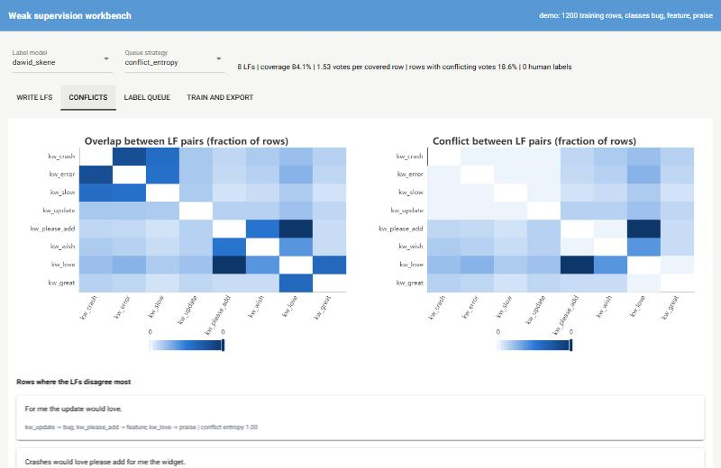
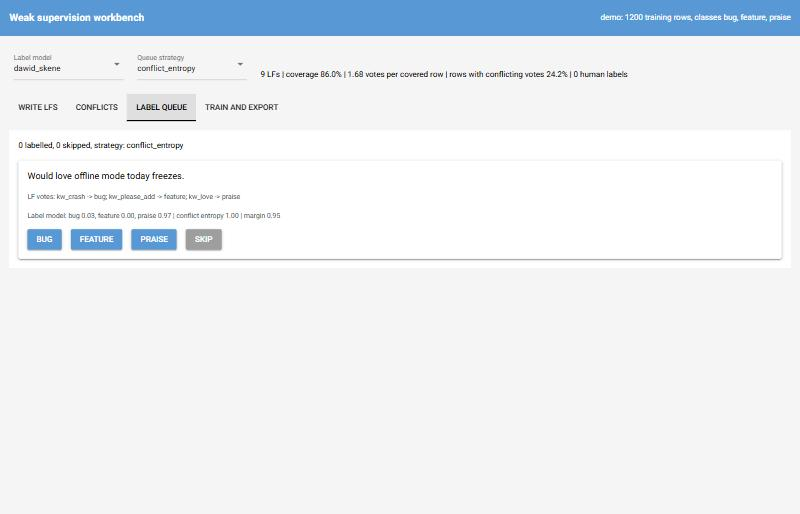
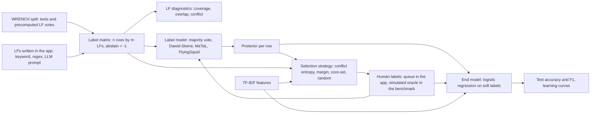

# weak-supervision-workbench

A small web app for building a labelled text dataset without labelling most of it by hand.
You write labelling functions (keyword lists, regular expressions, optionally an LLM prompt),
a label model works out how far to trust each one and turns their votes into probabilistic
labels, and a queue asks you to label only the rows where the functions disagree or the model
is unsure. A TF-IDF + logistic-regression end model is then trained on the result.

The statistical parts are written from scratch on numpy and scipy: the label matrix with
abstains, Dawid-Skene EM, the MeTaL matrix-completion model with class-balance estimation,
FlyingSquid's triplet method, LF diagnostics, three selection strategies, the soft-label end
model and a seeded simulated-oracle loop. Snorkel and scikit-learn appear only as reference
points in the benchmark and the tests. The benchmark runs on five WRENCH text-classification
sets and compares label models with majority vote and Snorkel, and selection strategies with
random sampling.

## Start the workbench

Needs [uv](https://docs.astral.sh/uv/) and Python 3.12.

```bash
uv sync
uv run wsw app                      # bundled demo corpus at http://127.0.0.1:8080
```

The demo corpus (synthetic app-store reviews: bug, feature, praise) is generated from a
fixed seed, so it needs no download. For the WRENCH sets:

```bash
uv run wsw fetch all                # about 70 MB, sha256-checked, into $WSW_DATA_DIR
uv run wsw app --dataset sms        # the app keeps a seeded 5000-row sample (--max-rows 0 for all)
uv run wsw lfs trec                 # the same LF diagnostics, printed in the terminal
```

`WSW_DATA_DIR` defaults to `~/.cache/weak-supervision-workbench`. The image runs the same app
as a non-root user:

```bash
docker build -t weak-supervision-workbench .
docker run --rm -p 8080:8080 weak-supervision-workbench
```

## A session, step by step

### 1. Write a labelling function

The **Write LFs** tab has one form. Pick *keyword* or *regex*, name the function, give the
keywords (comma-separated, matched as whole words or phrases, case-insensitive) or the
pattern, and choose the class it votes for. Everywhere else it abstains. On the demo corpus,
`kw_sync` with keywords `sync, export` voting *bug* is a reasonable first try.

After **Add LF** the table below updates. For every function it shows:

| Column | Meaning |
|---|---|
| Coverage | share of rows the function votes on |
| Overlap | share of rows where it votes and some other function votes too |
| Conflict | share of rows where it votes and another function votes a different class |
| Accuracy on human labels | how often it matches the labels you gave in the queue, and on how many rows |
| Accuracy estimated by label model | the label model's estimate of how often it is right when it votes, with no labels needed |

The definitions of coverage, overlap and conflict match Snorkel's `LFAnalysis`, and a test
checks that they agree. A function with high conflict and a low estimated accuracy is usually
too broad. The *label model* selector above the tabs switches between majority vote,
Dawid-Skene, MeTaL and FlyingSquid; posteriors and estimates update immediately.

If `WSW_LLM_BASE_URL` and `WSW_LLM_MODEL` point at any OpenAI-compatible server (OpenAI,
Ollama, vLLM, LM Studio; `WSW_LLM_API_KEY` if it needs one), a third kind, *llm*, appears: the
text box then holds an instruction, and the model is asked once per distinct row to answer
with one class name or `ABSTAIN`. Anything else counts as an abstain.

### 2. Read the conflicts



The **Conflicts** tab shows two heatmaps over pairs of functions: how often both vote, and how
often both vote and disagree. In the demo corpus the bright cell between `kw_please_add` and
`kw_love` is the planted trap: "would love" is a feature request, "love" on its own is praise.
Below the heatmaps are the rows with the most evenly split votes, which is usually where the
next keyword or exclusion comes from.

### 3. Label what the queue asks for



The **Label queue** tab shows one row at a time with the votes it received, the label model's
posterior, its LF-conflict entropy and its posterior margin. Answer with a class button or
skip. Each answer is clamped into Dawid-Skene (the posterior for that row becomes your label
and the model is refitted), counts towards *Accuracy on human labels*, and moves the queue on.
The strategy selector chooses what comes next:

| Strategy | Picks the row whose |
|---|---|
| `conflict_entropy` | LF votes are most evenly split between classes (entropy of the vote shares, divided by log k) |
| `posterior_margin` | label-model posterior has the smallest gap between its top two classes |
| `coreset` | TF-IDF vector is farthest from every row labelled so far (greedy k-center) |
| `random` | position is drawn at random |

Ties are broken at random from a fixed seed.

### 4. Train and export

**Train and export** fits the end model on the label model's soft labels (your labels replace
them where you gave one; rows no function covers are left out unless you labelled them) and
scores both the label model and the end model on the dataset's test split. **Download labels**
writes one JSON line per covered or human-labelled row with the label, its source and the
posterior probability.

> [!NOTE]
> **What the label models assume**
>
> * **Conditional independence.** Given the true class, the functions' votes are independent.
>   Two keyword lists that share words, or a function written to patch another, break this,
>   and the models then count the same evidence twice. MeTaL and FlyingSquid lean on it
>   hardest, because they estimate accuracies from how often functions agree.
> * **Better than random.** FlyingSquid takes the positive root of its triplet equations, and
>   the fitted models resolve which estimated class is which by assuming functions mostly vote
>   for the class they are written for.
> * **Abstaining.** Dawid-Skene models abstaining per class (silence can be evidence), MeTaL
>   treats an abstain as carrying no information, and FlyingSquid assumes abstaining is
>   independent of the class.
> * **A known class balance.** MeTaL and FlyingSquid need `P(y)`. In the app it is estimated
>   from three-way agreements between functions, which is only reliable when the independence
>   assumption roughly holds; the benchmark also reports it taken from labelled validation data
>   ([ADR 2](docs/adr/0002-class-balance-in-the-benchmark.md)).
> * **Same distribution.** The estimated accuracies describe the rows the model was fitted on.

## How the pieces connect



| Module | What is in it |
|---|---|
| `wsw.lf` | keyword, regex and Python LFs; label-matrix construction and checks |
| `wsw.labelmodels` | majority vote, Dawid-Skene, MeTaL, FlyingSquid, class-balance estimation |
| `wsw.diagnostics` | per-LF and pairwise coverage, overlap, conflict; conflict entropy |
| `wsw.active` | the four strategies and the seeded simulated-oracle loop |
| `wsw.endmodel` | TF-IDF vectoriser and soft-label logistic regression |
| `wsw.llm` | provider interface, OpenAI-compatible HTTP adapter, deterministic fake, LLM labelling function |
| `wsw.workbench`, `wsw.app` | session state and the NiceGUI page |
| `wsw.benchmark` | suites, machine facts, Markdown and SVG report |

Design decisions are recorded in [docs/adr](docs/adr).

## Learning curves on WRENCH

Measured on: Intel Core i5-8500 (6 cores), 12 GB RAM, Windows 10, CPU only. Date:
pending benchmark (it will be the date stored in `bench/results/full.json`).

Each strategy starts from the same Dawid-Skene fit with no human labels, asks for batches of
25, has them answered from the gold training labels, refits Dawid-Skene with those labels
clamped and retrains the end model at 25, 50, 100, 250 and 500 labels. Five seeds per
dataset. Yelp and AG News draw a 10000-row pool per seed; the other sets use their whole
training split. The figure and tables report end-model accuracy on the full test split,
mean and standard deviation over seeds. nAULC is the trapezoidal area under the curve from 25
to 500 labels divided by that range (the curve's average height); the bracket gives the mean
paired difference to random and on how many seeds the strategy beat it
([ADR 3](docs/adr/0003-shape-of-the-active-learning-experiment.md)).

*Learning-curve figure: pending benchmark* (`docs/learning-curves.svg`, written by
`wsw report`).

**nAULC of end-model accuracy (%)**

| Strategy | youtube | sms | trec | yelp | agnews |
|---|---|---|---|---|---|
| Random | pending benchmark | pending benchmark | pending benchmark | pending benchmark | pending benchmark |
| LF-conflict entropy | pending benchmark | pending benchmark | pending benchmark | pending benchmark | pending benchmark |
| Posterior margin | pending benchmark | pending benchmark | pending benchmark | pending benchmark | pending benchmark |
| Core-set (k-center) | pending benchmark | pending benchmark | pending benchmark | pending benchmark | pending benchmark |
| Random, human labels only | pending benchmark | pending benchmark | pending benchmark | pending benchmark | pending benchmark |

Per-budget curves for each dataset: pending benchmark.

## Label models and end models

Same machine and date as above. Label-model rows are scored on the whole test split,
including rows no function covers (those get whatever the model predicts for a row of
abstains; for majority vote that is a random class). Each end
model is trained on the corresponding label model's soft labels for the full training split.
Metric cells are accuracy / F1 in %, where F1 is the F1 of class 1 on the binary sets (spam on
YouTube and SMS, positive on Yelp) and macro-F1 on TREC and AG News. MeTaL, FlyingSquid and
Snorkel receive the class balance of the validation split, as in WRENCH; the *estimated
balance* rows use no labels at all ([ADR 2](docs/adr/0002-class-balance-in-the-benchmark.md)).
Snorkel's `LabelModel` runs with its default settings (100 epochs).

**Label models on the test split**

| Model | youtube | sms | trec | yelp | agnews |
|---|---|---|---|---|---|
| Majority vote | pending benchmark | pending benchmark | pending benchmark | pending benchmark | pending benchmark |
| Dawid-Skene | pending benchmark | pending benchmark | pending benchmark | pending benchmark | pending benchmark |
| MeTaL (balance from valid labels) | pending benchmark | pending benchmark | pending benchmark | pending benchmark | pending benchmark |
| MeTaL (estimated balance) | pending benchmark | pending benchmark | pending benchmark | pending benchmark | pending benchmark |
| FlyingSquid (balance from valid labels) | pending benchmark | pending benchmark | pending benchmark | pending benchmark | pending benchmark |
| FlyingSquid (estimated balance) | pending benchmark | pending benchmark | pending benchmark | pending benchmark | pending benchmark |
| Snorkel LabelModel (reference) | pending benchmark | pending benchmark | pending benchmark | pending benchmark | pending benchmark |

**End model on each label model's soft labels**: pending benchmark (same rows and columns).

**Fit time in seconds**: pending benchmark.

**Class balance, tensor estimate against the true training balance**: pending benchmark.

### Parameter recovery on synthetic label matrices

Label matrices sampled from exactly the model the label models assume (conditionally
independent LFs, abstaining independent of the class; 10 LFs, 20000 rows, two and four
classes, five seeds). Mean absolute error between estimated and true LF accuracies, and the
L1 error of the tensor class-balance estimate: pending benchmark.

### LLM labelling function

Not run. The provider and the LLM labelling function are covered by tests against a fake
provider and a local stub server; no benchmark number in this README involves an LLM.

## Reproducing the numbers

```bash
uv sync --group reference                                   # adds snorkel (and torch) for the reference row
uv run --group reference wsw fetch all
uv run --group reference wsw bench --suite full             # writes bench/results/full.json
uv run --group reference wsw report bench/results/full.json --svg docs/learning-curves.svg
```

Pass `--group reference` on every `uv run` once Snorkel is installed; a plain `uv run`
re-syncs the default environment and removes it. Without Snorkel the benchmark still runs and
marks that row "not run". `wsw bench --suite smoke` runs a two-seed version on the demo
corpus in about a minute and is what CI runs inside the image. Every results file stores the
CPU, core count, RAM, OS, Python and package versions, local date, git commit and the command.

## Development

```bash
uv sync
uv run ruff check . && uv run ruff format --check .
uv run pytest -q                                            # no network, no downloads
```

Tests marked `integration` need the WRENCH files and skip without them; tests marked
`reference` need Snorkel and skip without it. Hypothesis checks invariants such as
posteriors being distributions, Dawid-Skene being invariant to LF order and selection never
returning a labelled row; the NiceGUI tests drive the page with NiceGUI's simulated user.

## What it does not do

* The end model is TF-IDF and logistic regression. A pretrained encoder would score higher
  and might rank the selection strategies differently.
* Label models assume conditionally independent LFs; nothing here learns LF dependencies.
* The app keeps its state per browser tab and only in memory. Reloading the page starts over;
  export your labels first.
* Python LFs exist in the library (`wsw.lf.PythonLF`) but cannot be written from the page,
  on purpose: the page never executes code typed into it.
* Yelp and AG News learning curves use a 10000-row pool, not the full training split.
* The class-balance estimate is unreliable on correlated LFs (see the box above), so in the
  app MeTaL and FlyingSquid can be miscalibrated when nobody has labelled anything yet.
* The LLM labelling function sends each distinct row to the configured server once per
  function; on large datasets that is many requests, and no benchmark measures its quality.

## Datasets and their terms

| Data | Where it comes from | Terms |
|---|---|---|
| WRENCH (YouTube, SMS, TREC, Yelp, AG News subsets with LF outputs) | [WRENCH](https://github.com/JieyuZ2/wrench), Zhang et al., NeurIPS 2021 Datasets and Benchmarks; fetched from the authors' Hugging Face copy `jieyuz2/WRENCH` at a pinned revision, so the bytes and their sha256 stay fixed | `Apache-2.0` for the benchmark repository and its Hugging Face copy |
| YouTube spam comments | Alberto, Lochter and Almeida, TubeSpam (UCI YouTube Spam Collection) | `CC-BY-4.0` |
| SMS Spam Collection | Almeida and Gómez Hidalgo (UCI) | `CC-BY-4.0` |
| TREC question classification | Li and Roth, UIUC Cognitive Computation Group | distributed for research use; no explicit licence found |
| Yelp review polarity | Zhang, Zhao and LeCun (2015), from the Yelp Dataset Challenge | Yelp dataset terms: academic, non-commercial use, no redistribution |
| AG News | Zhang, Zhao and LeCun (2015), from AG's news corpus | academic, non-commercial use |
| Demo corpus | generated by `wsw.data.demo` from word lists | part of this repository (MIT) |

No dataset is stored in this repository or in the Docker image. `wsw fetch` downloads the
files on the user's machine and refuses any file whose sha256 differs from the values in
`src/wsw/data/wrench_sha256.json`. No pretrained model is used.

## Licence

MIT, see [LICENSE](LICENSE).
